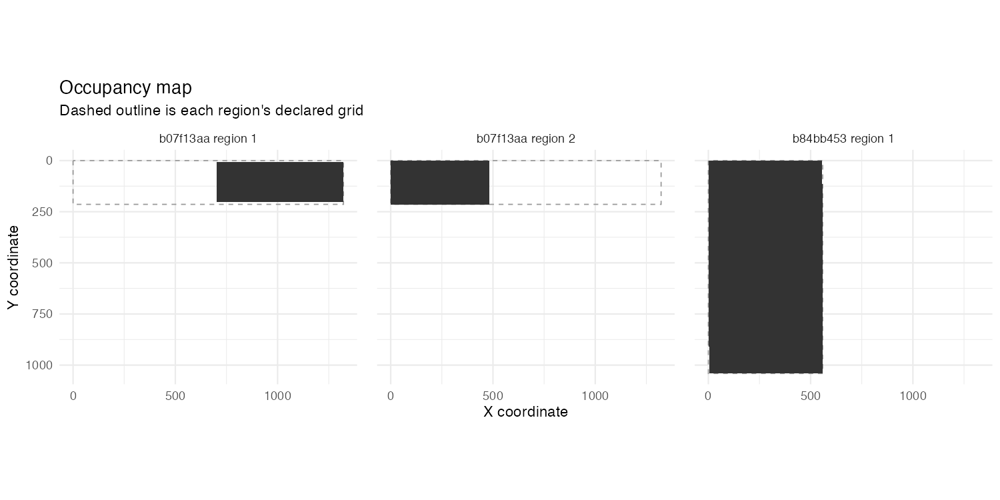
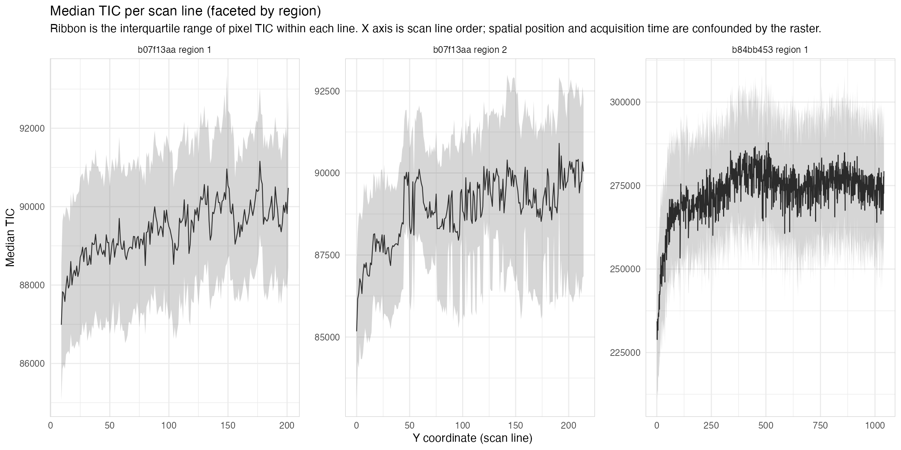
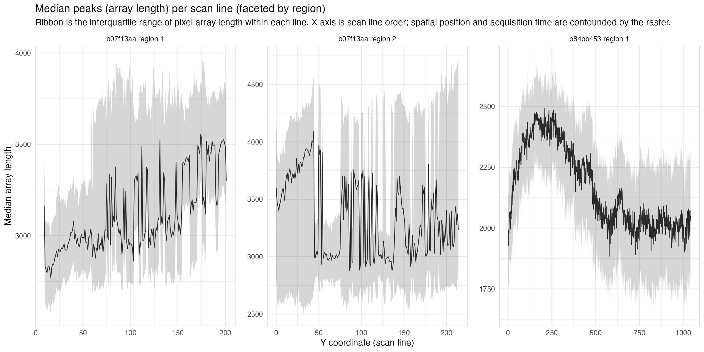
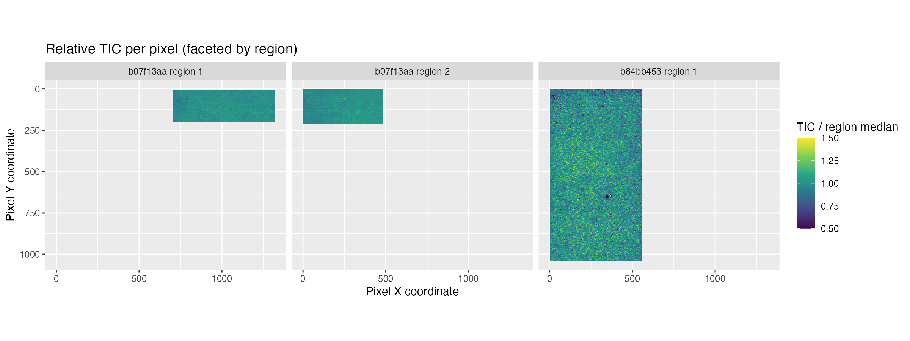
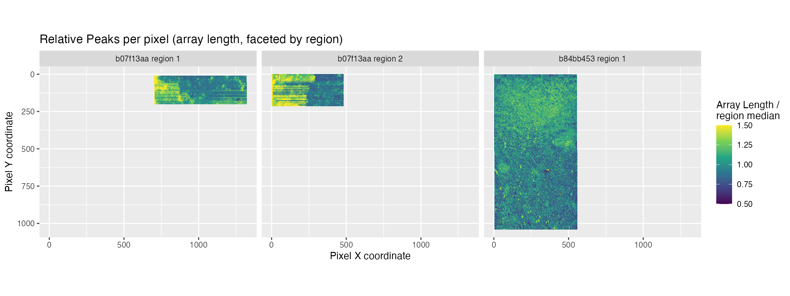
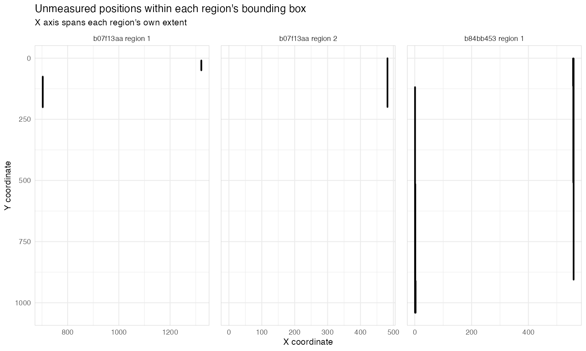

# Checking mass spectrometry imaging metadata against the data it describes

An R pipeline that validates published imaging mass spectrometry datasets against their own declared metadata, reading only the XML. On two public HuBMAP kidney datasets it found a declared grid matching neither acquisition region in the file, a declared mass range that no spectrum satisfies, conflicting tissue laterality across three metadata fields, and a spatial discontinuity in detected peak counts that total ion current does not show.

## Motivation:
By pooling data from many different Mass Spectrometry instruments, which have scanned hundreds of tissue sections from dozens of donors, a reference map (aka an *atlas*) of a human organ can be assembled at molecular resolution. 
This allows researchers to determine what specific molecules appear where in organs like kidneys or lungs. 

Atlas programs like HuBMAP (Human BioMolecular Atlas Program), KPMP (Kidney Precision Medicine Project), and LungMAP pool mass spectrometry imaging runs from a consortium of institutions over time in order to create comprehensive reference maps of organs for researchers. Pooling involves combining spectra from multiple acquisitions into a single analysis, which requires that they measured comparable things under comparable conditions. Therefore, before pooling is possible, it is crucial to ensure that the metadata from each run is consistent, as the contrary can cause biological signals to be confused with technical artifacts from measurements being taken under different conditions. 

In this project I test how comparable or consistent the metadata is from two different Matrix-Assisted Laser Desorption/Ionization (MALDI) datasets. In doing so, I set out to answer the question: ***What do comparability checks look like, and what would they catch on real published data?***

## Data:
Both datasets used in this project are from the left kidney, measured using Bruker mass spectrometers (one being a prototype), and both under the same Creative Commons Attribution 4.0 license.

| Field | b07f13aa | b84bb453 |
|---|---|---|
| HuBMAP ID: | HBM427.CPRT.535 | HBM968.KRRQ.694 |
| DOI: | [10.35079/HBM427.CPRT.535](https://doi.org/10.35079/HBM427.CPRT.535) | [10.35079/HBM968.KRRQ.694](https://doi.org/10.35079/HBM968.KRRQ.694) |
| Donor: | 70M | 77F |
| Instrument Model: | timsTOF FleX | MALDI timsTOF Flex Prototype |
| Spectra: | 223,135 | 578,809 |
| Declared grid: | 1322 × 214 | 559 × 1041 |

Data is from the Human BioMolecular Atlas Program (HuBMAP), generated by the
Biomolecular Multimodal Imaging Center (BIOMIC) at Vanderbilt University,
a HuBMAP Tissue Mapping Center. Both datasets are published under
[CC BY 4.0](https://creativecommons.org/licenses/by/4.0/). Per-dataset
contributor lists are included in each dataset's `extras/contributors.tsv`.

## Approach:

Every imzML dataset contains a `.imzML` XML metadata file and a `.ibd` binary file storing the actual m/z and intensity arrays. The b07f13aa dataset contains a 522 MB `.imzML` and a 5.97 GB `.ibd`, while the  b84bb453 dataset contains a 1.38 GB `.imzML` and a 9.99 GB `.ibd`. The .imzML XML data is structured such that each <spectrum> element represents one pixel, each with coordinates and cvParams: TIC, base peak mass-to-charge ratio (m/z) and intensity, lowest and highest observed m/z ratios. Therefore, a substantial set of per-pixel measurements is available without needing to open a binary at all.

The checks are therefore split in two: 

- **Tier 1** reads the XML only and covers coverage (`compute_coverage()`), region structure (`detect_regions()`), acquisition order (`verify_acquisition_quality()`), m/z range (`check_mz_range()` after `get_json_mz_window()`), TIC trajectory (`compute_tic_trend()` after `summarize_scan_lines()`), peaks per pixel (`compute_arrayLength_trend()` after `summarize_scan_lines()`), and identifier consistency (`check_identifier_consistency()` after `get_registered_organ()`). *All of these functions can be found in `qc-checks.R`.*

- **Tier 2** reads the binary for anything requiring the spectra themselves. Everything reported here is tier 1.

Checking which runs are comparable is only useful if it is applied to many different runs, and parsing all four files would require processing the binaries which are roughly eight times the size of the XML files. A tool meant to screen fifty runs pays its per-run cost fifty times, so an eight-fold difference compounds when scaled. The approach is therefore to read the cheap source first (XML), and reach for the expensive one (binary) only when a question needs it. Parsing both datasets' `.imzML` files end to end, including parsing, checks, and creating figures, took roughly 30 seconds. Every metric reported here for either dataset came from parsing the XML files alone. For b84bb453 that was not a choice, as its 9.99 GB binary was not on disk at the time, and all 578,809 spectra were characterised from a 1.38 GB XML file alone.

Visualizing TIC spatially for each dataset raised a question that cannot be answered by tier 1's XML data alone: *what makes a pixel's TIC elevated?* TIC is a sum of all intensities in a given pixel’s spectrum, so it can’t distinguish whether the whole spectrum is lifted, or only a few peaks are. Therefore, answering this question requires comparing spectra, which is what tier 2 would involve.


### What the tool checks:

- **Region Structure:** Computes number of regions in dataset, and their bounds.

**Within a region:**

- **Coverage:** Did the acquisition complete, and does the file’s claim match what it measured? Calculates and stores the declared grid coverage, calculated as `Spectrum_count / Declared_grid_size`.
- **Acquisition Order:** Confirms that the observed coordinate sequence matches the declared raster pattern. Rows contiguous in index, Y non-decreasing, X strictly increasing within each row, no duplicate pixels.
- **m/z range:** Compares each region's observed m/z range against the declared window. Comparison uses a small tolerance so that boundary-precision effects don’t register as violations.
- **TIC trajectory:** Computes the ratio of the last fraction's median TIC (from each scan line) to the first. Fraction is 5% of the scan lines in a region, but is a customizable parameter.
- **Peaks per pixel:** Similarly, computes the ratio of the last fraction's median array length (peaks per pixel) from each scan line to the first. Fraction is 5% of the scan lines in a region, but is a customizable parameter.
 
**Across sources:** 

- **Identifier consistency:** Compares the laterality implied by the imzML's
  internal run identifier against the organ registered in `metadata.json`.
  Returns match, mismatch, not determinable, or conflicting registered organ.


## Findings:
### 1. A file containing two acquisition regions:

b07f13aa contains two acquisition regions rather than one, each essentially fully sampled within its own extent at 99.86% and 99.81%. 

This was first determined by observing that the coordinates reset at index 119,492, at which point the Y coordinate goes from 201 down to 0. Region 1's X coordinates span 703 to 1322, and its Y coordinates span 9 to 201. Region 2's X coordinates span 0 to 482, and its Y coordinates span 0 to 214. This also tells us that the X ranges don’t overlap, as nothing was measured between X = 483 and X = 702, a gap of 220 columns. Finally, region 1 starts at (703, 9), while region 2 at (0, 0). One is 1-based and offset, the other 0-based.



The plot is consistent with two tissue sections on one slide, acquired as separate regions of interest. The two regions have non-overlapping X coordinate ranges, and the region2 string in the run id (`\\10.33.2.5\msrc\autoims\hubmap_kidney\positive-redo\results\single-dataset\...imzml\VAN0103-RK-4_region2_roi=#all_mz=fix;raw;TIC`) is consistent with the potential for b07f13aa to legitimately have two separate regions.


### 2. A declared grid that describes neither region
The b07f13aa imzML file declares a grid of 1322 × 214, but neither region matches it.

| Region | Observed X max | Observed Y max | Declared grid | Matches declaration |
|---|---|---|---|---|
| b07f13aa region 1 | **1322** | 201 | 1322 × 214 | no |
| b07f13aa region 2 | 482 | **214** | 1322 × 214 | no |
| b84bb453 region 1 | **559** | **1041** | 559 × 1041 | yes |

>*Table 1. Observed extents against the declared grid. Bold values match the corresponding declared dimension.*

Across both regions of b07f13aa, the declared maximum count of pixels X is 1322, and the declared maximum count of pixels Y is 214. Region 1 never exceeds Y = 201 and region 2 never exceeds X = 482, so the declared dimensions are per-axis maximums taken across two separate acquisitions, describing a rectangle no acquisition covered.

If a tool were to treat the b07f13aa's file as one coordinate space, it would read 223,135 spectra against a declared 282,908 and report 78.9% coverage. Instead of looking like a run with substantial gaps, this identifies two regions that are actually 99.8% complete.

Comparing the declared grid against each region's extent in that grid caught a mismatch in b07f13aa, and passed without mismatches in b84bb453's declared grid of 559 × 1041, matching the coordinate space exactly. This serves as supporting evidence that the check works.

This finding suggests that the writer of the file may have taken a maximum over all spectra without accounting for multiple coordinate spaces.


### 3. A declared m/z window that no spectrum satisfies

b84bb453 declares an m/z range of 400 to 2000, but observes a range of 250 to 1250. In every one of the 578,809 spectra, the lowest m/z ratio is below the declared low of 400. 

| Region | Declared window | Observed range | Spectra below floor | Window used |
|---|---|---|---|---|
| b07f13aa region 1 | 300 – 2000 | 299.999 – 2000.000 | 0 of 119,491 | 100.0% |
| b07f13aa region 2 | 300 – 2000 | 299.999 – 1999.999 | 0 of 103,644 | 100.0% |
| b84bb453 region 1 | 400 – 2000 | 250.001 – 1249.994 | **578,809 of 578,809** | 53.1% |

> `Window used` is the overlap between the observed and declared ranges, as a fraction of the declared window. Violations are counted with a 0.01 m/z tolerance; without it, boundary-precision effects flag 90 spectra in b07f13aa sitting 0.0009 below the declared floor.

b07f13aa declares 300 to 2000 and observes 299.999 to 2000.000, matching to within 0.001. So the declaration can be accurate, and in the same consortium and assay. Every spectrum sits 150 m/z units below the floor, and the run stops 750 units below the declared ceiling, using 53.1% of the window it declares.

Either the field was entered incorrectly, or it describes a different acquisition. Nothing in the public files distinguishes those. An imzML can declare a scan window via MS:1000500 and MS:1000501, and neither file does. So the only declared range is in the consortium’s metadata.json rather than in the instrument’s own output. That matters because it means the file cannot be checked against itself on this axis: the comparison necessarily crosses two sources.

The protocol b84bb453 cites for sample preparation (protocols.io.n92ldpq99l5b) states a range of m/z 400 to 2000 in its abstract, matching the declared window exactly. That suggests the declaration might have been transcribed from the documented procedure rather than recorded from the acquisition, which would make it an accurate description of intent but an inaccurate description of what the instrument measured.

### 4. A dataset that states two different kidney lateralities

b07f13aa states two different kidney lateralities for the same dataset. Two registered organ fields say left kidney, the upload.intended_organ field says right, and the imzML’s internal run identifier agrees with the minority value.


| Dataset_ID | Registered organ | Run id laterality | Verdict | Organ values |
| --- | --- | --- | --- | --- |
| b07f13aa | NA | RK | conflicting registered organ | **LK** (`organs$[[1]]$organ`); **LK** (`samples$[[2]]$direct_ancestor$organ`); **RK** (`upload$intended_organ`)
| b84bb453 | LK | NA | not determinable | **LK** (`organs$[[1]]$organ`); **LK** (`samples$[[2]]$direct_ancestor$organ`); **LK** (`upload$intended_organ`)

***Note:** the run id isn’t exposed by CardinalIO, so reading it required going back to the raw XML. Secondly, HuBMAP IDs seem to contain random letters and numbers, so a HuBMAP ID can contain “RK” without necessarily meaning right kidney. Therefore, LK/RK tokens were matched only as delimited tokens.*

The correct kidney value cannot be determined for b07f13aa using its published files. The field name `intended_organ` suggests it records what was planned rather than what was registered, so a divergence between it and the registered organ fields may be expected within HuBMAP's model. Additionally, the RK laterality in the dataset's run id agrees with the "intended organ" value. In b84bb453 the same three fields agree, though there is no laterality declared in the run id, so the verdict remains uncertain instead of guessing.


### 5. TIC and Array Length (peaks per spectrum) disagree about the same pixels

In dataset b07f13aa, region 1 shows similar behavior between TIC and array length, both rising gradually over time. In region 2, on the other hand, TIC continues to gradually increase with each new scan line, while array length similarly increases until around scan line 50 where it quickly drops from roughly 4000 peaks to about 3000 (then begins to exhibit erratic variation). The array length trend in both regions has substantially more variation than in TIC though, evidence of horizontal striping, which appears somewhat constant within each scan line and is visualized in the later spatial plots. 

In dataset b84bb453, TIC rises quickly over the first ~100 scan lines, then continues to rise until scan line ~480 before lowering slightly to ~275,000 and flattening for the remaining 900 scan lines. Array length rises to a peak around scan line 250, then declines steadily from ~2,450 to ~2,000 at scan line 750, a 20% drop, and stays there.

**TIC and Array Length drifts:**



Array length tells us how many peaks a spectrum (pixel) contains, but can't tell us what those values are. A line where the peak count drops might have lost low-intensity peaks to a higher threshold, or might have retained entirely different species. Both look identical from the XML metadata, because the XML only records how many. Therefore, distinguishing potential culprits means reading the arrays themselves, which tier 2 would involve.

**TIC and Array Length spatial maps:**



Spatial maps reveal that array length is far more varied than TIC. Both maps cover the same pixels, but TIC is spatially smooth in both b07f13aa regions while array length splits at a sharp vertical boundary. In region 1, array length drops off at x≈850, roughly the 1/3 point of the region's width, and in region 2, array length drops off at x≈250, roughly the 1/2 point of the region's width. 


### 6. Unmeasured positions confined to the first and last columns of each scan line

All 3,480 unmeasured positions across the three regions lie within three columns of the left or right edge of their bounding box. There are 169 missing spectra in b07f13aa region 1, 201 missing in region 2, and 3,110 missing in b84bb453. 

**Missing spectra in each dataset:**


The gaps form vertical bands, each spanning a range of scan lines rather than a region's full height. 

| Region | Scan lines | Unmeasured positions | X-coordinates affected |
|---|---|---|---|
| b07f13aa region 1 | 193 | 169 | 703, 1322 |
| b07f13aa region 2 | 215 | 201 | 482 |
| b84bb453 region 1 | 1,041 | 3,110 | 1, 2, 3, 557, 558, 559 |

> Region extents are x 703–1322, x 0–482, and x 1–559 respectively, so every affected column sits at or within three positions of an edge. No column is missing from every line: a minority of lines are complete (24 in b07f13aa region 1, 14 in region 2), and which positions are dropped varies line to line.

Because every missing spectrum is within at most three columns of a region's edge, their cause operates at the start and end of scan lines, ruling out a dead spot or sporadic dropout. 

b07f13aa region 1 and b84bb453 have missing spectra on both their left and right edges, whereas b07f13aa region 2 is only missing spectra on its right edge. This pattern could suggest that the missing points are caused by the mechanical stage accelerating and decelerating, although the asymmetrical missingness fits this hypothesis poorly and the published files do not provide any information to determine the cause.

My initial hypothesis was that acquisition followed an outline of the tissue, producing gaps where the tissue section ended. The occupancy maps paired with the missing spectra plot rejected this hypothesis, revealing that all three regions render as solid rectangles with gaps only at the extremes of scan lines.


## What these have in common

Findings one through four are the same shape, where a file states something about itself that its own data contradicts: 
- A file describing one acquisition that contains two
- A grid of 1322 × 214 that neither region occupies
- An m/z window of 400–2000 that no spectrum satisfies 
- A laterality stated three ways, two of which disagree 

Because neither file announces its own data inconsistencies, each of these findings would go unseen by a tool that simply reads what the imzML files declare at face value. In this project, each finding was caught by comparing two statements about the same fact, where each statement either came from two different parts of the imzML file, or from the metadata.json against the corresponding imzML file.

The pattern isn’t only about declarations that don't line up with the data, though; finding 5 has no declaration in it at all. TIC and peak counts, both computed from the same file, disagree about whether the run is stable. Additionally, only the spatial array length (peaks per pixel) map shows the spatial discontinuity in which array length has a sharp drop across scan lines at a similar vertical point along the x-axis in both regions of b07f13aa. 

As finding two described, b07f13aa did not initially look like a run with two 99.8%-complete regions. Without checking the data against what the file declared, b07f13aa would look like a failed run with 78.9% coverage, and could be excluded on the strength of a number that describes no actual acquisition. Similarly, a check reading only declarations would compute the m/z overlap as the 1,600 units from 400–2000, whereas the observed usable overlap is 950 units from 300–1250. Because b84bb453 has nothing above 1250, pooling on the declared overlap would make any species above 1250 look absent from one donor when the instrument simply never looked there. 

Softer differences are worth flagging: the two datasets cite different preparation and acquisition protocols, and the same protocol identifier (protocols.io.n92ldpq99l5b) appears under analysis_protocol_doi in one dataset and preparation_protocol_doi in the other; its title describes data acquisition, so one of the two fields is likely mislabeled. The version b07f13aa cites (v8) redirects to a 404 page, while b84bb453's (v1) does redirect properly. The two files also differ in coordinate convention, and one contains two acquisition regions where the other contains one.

With this in mind, it is important to note again that both datasets are from one tissue mapping center, therefore these may reflect one lab's pipeline rather than general practice.


## Limitations

- **Two datasets from one mapping center:** both datasets come from the same HuBMAP Tissue Mapping Center (BIOMIC at Vanderbilt), so these may reflect one lab’s pipeline rather than general practice. No basis for claiming how common any of the findings are without expanding to many more datasets.
- **Tier 1 only:** Nothing here reads the `.ibd` binary, so the spectra themselves were never examined. That leaves two questions open that the binary alone could answer without chemistry: **(1)** whether the shorter peak lists on one side of b07f13aa’s discontinuity contain the same masses as the longer ones minus the weakest, or a different set of masses entirely, and **(2)** whether elevated pixels are lifted across the whole spectrum or only in a few peaks.
- **No domain expertise:** These are data-engineering checks on metadata and summary statistics. Identifying what a mass corresponds to, judging whether a compositional difference is biologically meaningful, and recognising which of these patterns are known instrument or preparation behaviour all require the knowledge of someone who works with these instruments. The findings are therefore stated as observations.
- **The TIC confound:** The raster moves line by line, so a scan line's position on the slide and its position in acquisition time are essentially the same variable. A trend in TIC against scan line could be the result of instrument behaviour or tissue structure, and the metric alone cannot separate them. The spatial map is the control, and for these runs it shows no gradient matching the trajectories, but a weak spatial effect would not be visible that way.
- **Peak counts aren’t comparable:** The number of peaks in a spectrum depends on where the peak-picking threshold was set, and that parameter is not recorded in the imzML, the metadata, or anywhere else I could find in the published files. Two runs processed with different thresholds would give different counts from identical tissue. The metric is therefore meaningful within a run and not between runs.
- **The missing-position check does not scale:** It constructs every position each region's bounding box contains and subtracts the measured ones, materialising roughly 805,000 rows to find 3,480. This works fine for three regions, but not for many more. Comparing each scan line's observed X values against its expected range could give the same answer without building the grid.
- **Region detection assumes a one-way, top-down raster:** It finds boundaries by looking for a drop in Y, which is only meaningful if Y increases monotonically through the acquisition. Both files declare that pattern, and the tool reads the declaration, but a serpentine or multi-pass raster would need different logic.


## Running it

Requires R with `CardinalIO` (Bioconductor), and `dplyr`, `ggplot2`, `tidyr`
and `jsonlite` from CRAN.

```r
install.packages("BiocManager")
BiocManager::install("CardinalIO")
install.packages(c("dplyr", "ggplot2", "tidyr", "jsonlite"))
```

Each dataset needs its `.imzML` file and its `metadata.json` in one directory.
HuBMAP has these at different levels of the dataset tree (`metadata.json` at
the root, the imzML pair under `raw/imzML/`), so they have to be placed
together:

```
data/
  b07f13aa/
    VAN0103-LK-4-27_region2_roi-all_mz-fix-raw-TIC.imzML
    metadata.json
  b84bb453/
    VAN0031-LK-2-80-IMS_lipids_pos.imzML
    metadata.json
```

The data is not included in this repository. Both datasets are public and can be downloaded from the HuBMAP portal at the DOIs in the Data section above, via Globus. Within each dataset, `metadata.json` sits at the root and the imzML pair is under `raw/imzML/`. The two `.imzML` files are 522 MB and 1.38 GB; their paired `.ibd` binaries are 5.97 GB and 9.99 GB and are not needed, since every check here reads the XML only.

Point the registry at the top of `main.R` at whichever datasets you have:

```r
DATASETS <- list(
  b07f13aa = list(
    imzml = "data/b07f13aa/VAN0103-LK-4-27_region2_roi-all_mz-fix-raw-TIC.imzML",
    metadata = "data/b07f13aa/metadata.json"
  )
)
```

Then:

```r
source("main.R")
```

Summary tables print to the console; figures are written to `figures/`.


## Full output

The per-region summary the tool produces, joining region structure, coverage,
m/z range, trend metrics, and acquisition-order verdicts. Each finding above
draws from one or more of these columns.

| | b07f13aa r1 | b07f13aa r2 | b84bb453 r1 |
|---|---|---|---|
| Spectra | 119,491 | 103,644 | 578,809 |
| Index range | 1 – 119,491 | 119,492 – 223,135 | 1 – 578,809 |
| X range | 703 – 1322 | 0 – 482 | 1 – 559 |
| Y range | 9 – 201 | 0 – 214 | 1 – 1041 |
| Bounding box | 119,660 | 103,845 | 581,919 |
| Bounding box occupancy | 99.86% | 99.81% | 99.47% |
| Coordinate base | NA | 0 | 1 |
| Declared grid size | 282,908 | 282,908 | 581,919 |
| Declared grid coverage | 42.24% | 36.64% | 99.47% |
| Grid matches a region | FALSE | FALSE | TRUE |
| Regions in file | 2 | 2 | 1 |
| Declared m/z | 300 – 2000 | 300 – 2000 | 400 – 2000 |
| Observed m/z | 299.999 – 2000.000 | 299.999 – 1999.999 | 250.001 – 1249.994 |
| Spectra outside window | 0 | 0 | 578,809 |
| Declared window used | 100.0% | 100.0% | 53.1% |
| TIC last/first | 1.02 | 1.04 | 1.09 |
| Array length (peaks) last/first | 1.23 | 0.94 | 0.93 |
| Acquisition order checks | all pass | all pass | all pass |